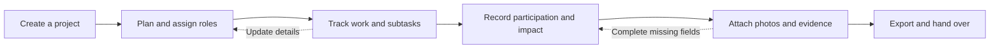
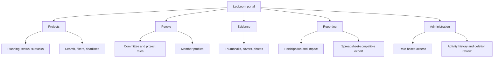
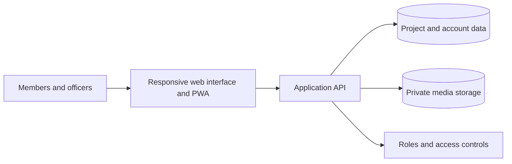

# LeoLoom

### A clearer way to plan, document, and report service projects

**Project management · Member coordination · Evidence · Reporting**  
Digital secretary portal | 2026/27 service year

LeoLoom is a digital secretary portal that turns fragmented project information into a clear, lasting record of service. It connects planning, people, progress, evidence, and impact in one shared workspace, so officers can manage work as it happens and carry reliable records into reporting and future handovers. Built around the real administrative demands of a volunteer service club, it makes continuity part of the workflow instead of an afterthought.

This repository is a public case study; the application source and operational data remain private.

---

## At a glance

| Challenge | LeoLoom's approach |
| --- | --- |
| Details scattered across messages, files, and devices | One structured record per project |
| Repeated follow-up before reporting deadlines | Progress and missing information remain visible throughout the project |
| Responsibilities becoming unclear after a board change | Project roles and historical assignments stay with the record |
| Photographs separated from project information | Media is organized alongside the relevant project |

## How a project moves through LeoLoom

The portal tracks **project status** and **record completeness** separately. An activity may be finished while its report still needs details. That distinction helps officers see the actual documentation gap.

## Feature map

### What the records contain

Project records can capture dates, venue, category, assigned members, chairperson, secretary, treasurer, subtasks, participant counts, beneficiaries, service hours, funds, project value, community needs, objectives, descriptions, and notes. Search and status filters make these records easier to find. Due-date indicators and completeness progress help identify work that needs attention.

Historical assignments remain on earlier projects when committee membership changes. Images are kept separately from ordinary project data to keep routine browsing lightweight.

## From prototype to final portal

| Stage | Main change |
| --- | --- |
| Local prototype | A single browser page stored data on one device. |
| First shared implementation | Spring Boot and SQLite enabled shared project records, a dashboard, committee management, photos, and export. |
| Final contribution | Individual accounts, Administrator/Admin/Member roles, email verification, profiles, activity history, deletion review, more media support, and a Progressive Web App interface. A TypeScript serverless API was also added for hosted operation. |

The two private repositories document stages of the same project. The later portal is the final contribution.

## Technical design

- **Application:** Java 17, Spring Boot, REST endpoints, and Spring Data JPA.
- **Data:** SQLite for local use, with PostgreSQL support in the final hosted implementation.
- **Hosted API:** TypeScript serverless API alongside the Spring Boot application.
- **Interface:** HTML, CSS, and framework-free JavaScript with responsive layouts and Progressive Web App files.
- **Media:** Images are reduced before upload; the final implementation includes private object-storage support.
- **Access:** Administrator, Admin, and Member roles. Public member details are separated from private contact information.

This diagram shows the main responsibilities of the system, not a complete deployment topology. The source demonstrates these capabilities; this report does not claim measured time savings, adoption figures, or uptime.

## Why it matters

LeoLoom makes project documentation an ongoing part of the work. A consistent record can show what was planned, who was responsible, what happened, and which evidence supports the report. That gives current officers a clearer view of their projects and gives future officers a more useful archive at handover.

## About this public report

This case study was prepared from the project's two private development repositories and its project report. It intentionally omits the club's identity, member names, private records, credentials, internal endpoints, and operational URLs. It contains no application source code or private project data.

